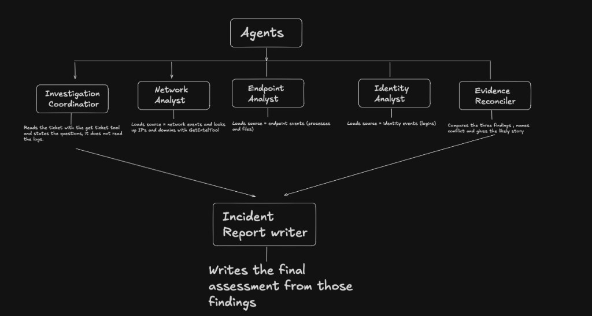

# CyberRecon

CyberRecon is a multi-agent investigation assistant. When a security incident comes in, separate agents read different evidence: network connections, endpoint activity, and logins. They can disagree. A reconciler compares those findings and a report writer explains what most likely happened, which event IDs support it, where the evidence conflicts, and what a human analyst should do next.

The system does not block hosts, change firewalls, or run attacks. It only reads a local evidence store and writes an assessment.

## Agents



## How an investigation runs

1. A case is loaded from JSON into SQLite.
2. The coordinator reads the ticket and states the question.
3. The network analyst reads connection and DNS events and checks indicators against a local intel snapshot.
4. The endpoint analyst reads process and file events.
5. The identity analyst reads login events.
6. The reconciler compares the three findings and names any conflict.
7. The report writer produces the final assessment.

Each specialist can only use rows returned by its tools. The report is rejected if it cites an event ID that is not in the database.

Saved write-ups go to `runs/<case>/<timestamp>/`, with one file per agent plus `report.md`.

## Cases

These are synthetic incidents, written for this project. They are not logs from a live network.

| Case | What the evidence shows |
|---|---|
| `case-a` | Ordinary office login, browser, and company mail. The three sources agree. |
| `case-b` | Login looks normal, but a document starts an unusual process and the host connects repeatedly to an address in the intel snapshot. |
| `case-c` | A second successful login appears from another country minutes later. The workstation itself stays quiet. |
| `case-d` | Many HTTPS connections, but they come from a corporate updater to an allowlisted address. |
| `case-e` | One connection to an address that is not in the intel snapshot, from a browser, after a normal login. The result should stay uncertain. |

Expected answers live in `eval/gold.json`. The agents are not given that file.

## Layout

| Path | Contents |
|---|---|
| `data/incidents/` | Incident JSON: ticket text and events |
| `data/intel/` | Local indicator snapshot |
| `data/knowledge/` | Notes the reconciler can use when judging a pattern |
| `db/schema.sql` | SQLite tables for incidents, events, and intel |
| `src/cyberrecon/` | Ingest, query tools, crew, and citation check |
| `runs/` | Saved agent outputs from past investigations |

## Run

```bash
python3 -m venv .venv
source .venv/bin/activate
pip install -r requirements.txt
cp .env.example .env
```

Put `OPENAI_API_KEY` in `.env`. That file is not part of the repository.

```bash
python main.py ingest
python main.py demo case-b
python main.py investigate case-b
```

`demo` prints the ticket, events, and intel lookups without calling a model. `investigate` runs the six agents and writes a folder under `runs/`.
